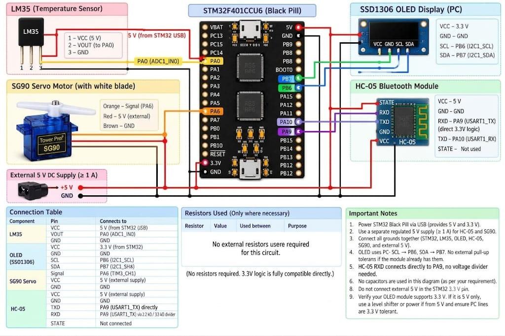
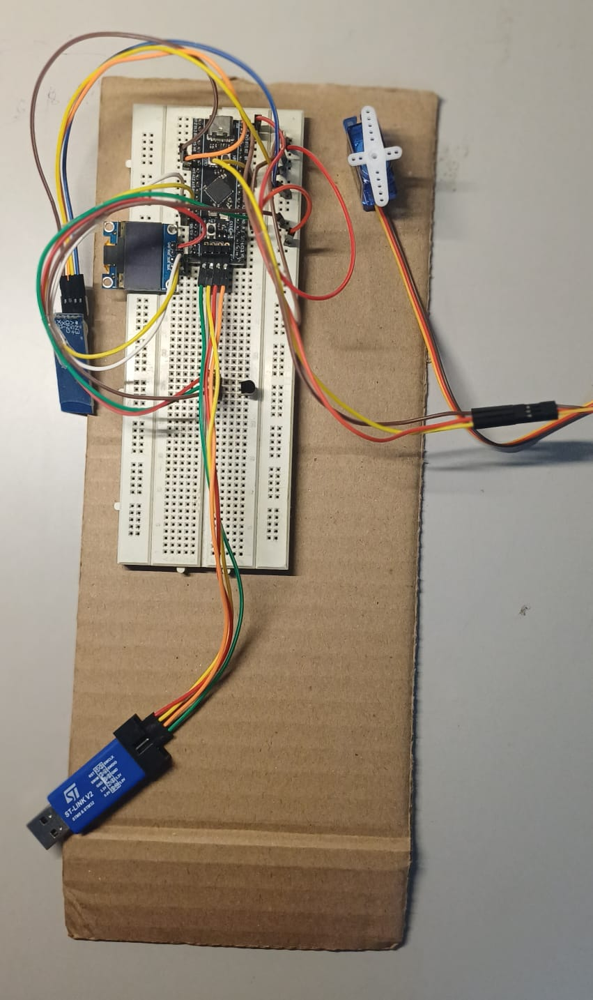

# Temperature-Based Automatic Fan Speed Controller

An Embedded Systems project that monitors temperature using an LM35 sensor and controls fan modes through an STM32 microcontroller. The system supports automatic temperature-based control as well as manual control over Bluetooth. An OLED displays the current temperature, fan mode, and control mode, while a Python desktop application provides live temperature plotting and command buttons.

## Table of Contents

- [Project Overview](#project-overview)
- [Features](#features)
- [Hardware and Software Requirements](#hardware-and-software-requirements)
- [System Architecture](#system-architecture)
- [Circuit Diagram and Pin Connections](#circuit-diagram-and-pin-connections)
- [Fan Control Logic](#fan-control-logic)
- [Project Structure](#project-structure)
- [How to Run the STM32 Code](#how-to-run-the-stm32-code)
- [How to Run the Python GUI](#how-to-run-the-python-gui)
- [Bluetooth Commands](#bluetooth-commands)
- [Prototype](#prototype)
- [Video Demonstration](#video-demonstration)
- [Team and Project Information](#team-and-project-information)

## Project Overview

The Temperature-Based Automatic Fan Speed Controller is designed to adjust the fan operating mode according to the surrounding temperature. The LM35 temperature sensor provides an analog temperature signal to the STM32 microcontroller. The controller reads this signal using the ADC and selects a fan mode based on predefined temperature thresholds.

It also provides a manual control option through an HC-05 Bluetooth module. An SSD1306 OLED display shows system information, and a Python-based GUI receives temperature readings, plots them in real time, and allows the user to change the operating mode.

## Features

- **Automatic mode:** Selects a fan mode based on the LM35 temperature reading.
- **Manual Bluetooth control:** Allows the user to select LOW, NORMAL, HIGH, or STOP.
- **OLED display:** Displays temperature, fan mode, and current control mode.
- **Live temperature monitoring:** Sends telemetry over Bluetooth serial communication.
- **Python desktop GUI:** Displays the current temperature, raw telemetry, command buttons, and a live temperature graph.
- **PWM-based servo control:** Uses TIM3 PWM output to control the servo position and sweep rate.

## Hardware and Software Requirements

### Hardware

- STM32F4-series development board (use the exact MCU/device variant matching your board)
- LM35 temperature sensor
- HC-05 Bluetooth module
- SSD1306 I2C OLED display
- Servo motor
- ST-LINK programmer/debugger
- Jumper wires and suitable power supply

### Software

- Keil µVision 5
- STM32F4 device support / CMSIS and startup files appropriate for the target MCU
- Python 3
- Python packages listed in `requirements.txt`
- Bluetooth serial/COM port available on the computer

## System Architecture

1. The LM35 produces an analog voltage corresponding to the measured temperature.
2. The STM32 reads the sensor voltage through ADC1 on PA0 and converts the ADC value into a temperature value.
3. In AUTO mode, the firmware selects LOW, NORMAL, or HIGH according to the configured thresholds.
4. TIM3 generates a PWM signal on PA6 to control the servo.
5. The SSD1306 OLED is updated with the temperature, fan mode, and control mode.
6. The STM32 sends telemetry through USART1 to the HC-05 module.
7. The Python GUI reads the serial telemetry, plots temperature samples, and sends manual commands back to the STM32.

## Circuit Diagram and Pin Connections




### Firmware pin mapping

| Module / Function | STM32 pin | Firmware peripheral |
|---|---|---|
| LM35 analog output | PA0 | ADC1 channel input |
| Servo signal | PA6 | TIM3_CH1 PWM |
| HC-05 RX connection | PA9 | USART1_TX |
| HC-05 TX connection | PA10 | USART1_RX |
| OLED SCL | PB6 | I2C1_SCL |
| OLED SDA | PB7 | I2C1_SDA |
| ST-LINK programming | SWDIO / SWCLK | SWD interface |

**Connection reminders**

- Connect the LM35 output to PA0, with the sensor supply and ground connected according to its datasheet.
- Connect the HC-05 module's TX to PA10 (STM32 RX), and the module's RX to PA9 (STM32 TX). UART connections are crossed.
- Connect the OLED's SCL and SDA to PB6 and PB7 respectively.
- Connect the servo signal wire to PA6. Power the servo from a supply capable of providing its current; do not draw servo motor power from an MCU GPIO pin.
- Connect ST-LINK SWDIO, SWCLK, GND, and the required target reference/reset connections according to the development board.
- Check voltage compatibility and the exact board pinout before wiring. Do not connect a 5 V signal to an STM32 input unless the pin is explicitly 5 V tolerant.

## Fan Control Logic

The thresholds and servo sweep limits are defined in `FanController.c`:

| Condition in AUTO mode | Selected mode |
|---|---|
| Temperature below 32 °C | LOW |
| Temperature from 32 °C through 37 °C | NORMAL |
| Temperature above 37 °C | HIGH |

Manual mode overrides the automatic selection until AUTO mode is selected again.

The servo sweep is configured between 30° and 150°. The firmware changes the delay between servo steps according to the selected mode:

- LOW: 10 ms delay
- NORMAL: 5 ms delay
- HIGH: 1 ms delay
- STOP: servo is moved to its centre position (90°)

These are the values in the current source code; they can be adjusted in `FanController.c`.

## Project Structure

```text
Temperature-Based-Automatic-Fan-Speed-Controller/
├── FanController.c       # STM32 firmware: sensor, PWM, OLED and Bluetooth control
├── Fanplotter.py         # Python GUI, serial communication and live temperature plot
├── requirements.txt     # Python dependencies
└── README.md
```

## How to Run the STM32 Code

 `FanController.c`

1. **Connect the board:** Connect the STM32 board to the computer using ST-LINK. Complete the sensor, OLED, Bluetooth, and servo wiring using the pin mapping above.
2. **Open Keil µVision 5:** Launch Keil µVision 5.
3. **Open or create the project:** Open the existing project if you have one. Otherwise, create a new µVision project and select the exact STM32F4 device used by your board. The setup screenshots show the STM32F401C-Discovery device selection; choose that only if it matches your hardware.
4. **Configure software components:** Ensure the device support, CMSIS, startup code, and required device headers are available for the selected MCU.
5. **Add the firmware source:** In the project tree, add `FanController.c` to a source group. Ensure the project can resolve the `stm32f4xx.h` header.
6. **Configure the debugger/programmer:** Open **Options for Target → Debug** and select the ST-LINK debugger. Check the Utilities/download settings as required by your board and Keil installation.
7. **Build the project:** Select **Project → Build Target** (or press `F7`). Resolve any device-pack, include-path, or configuration errors before proceeding.
8. **Download to the board:** Use **Flash → Download** (or the configured download button) to program the STM32. Wait for the programming and verification process to complete.
9. **Run and verify:** Reset or run the target. Check that the OLED initializes and displays the temperature, fan mode, and control mode. Verify the Bluetooth link and servo response.

## How to Run the Python GUI

1. Install Python 3.
2. Clone or download this repository.
3. Open a terminal in the project directory.
4. Install the required packages:

   ```bash
   pip install -r requirements.txt
   ```

5. Pair the computer with the HC-05 Bluetooth module.
6. Find the **outgoing** Bluetooth serial COM port assigned by Windows.
7. Open `Fanplotter.py` and change the `COM_PORT` value from `COM5` to the outgoing COM port on your computer:

   ```python
   COM_PORT = 'COM5'
   ```

8. Make sure the STM32 is powered and running, then start the GUI:

   ```bash
   python Fanplotter.py
   ```

9. The GUI should show the incoming temperature telemetry and update the live graph. Use the command buttons to change the fan mode.

If the GUI reports that the serial port cannot be opened, check the COM port number, Bluetooth pairing, and whether another application is already using that port.

## Bluetooth Commands

Commands are sent as single characters. Lowercase commands are also accepted by the firmware.

| Command | Action |
|---|---|
| `A` | Switch to automatic temperature-based mode |
| `L` | Manual mode – LOW |
| `N` | Manual mode – NORMAL |
| `H` | Manual mode – HIGH |
| `S` | Manual mode – STOP |

## Prototype

The prototype photograph is included below.



## Video Demonstration

<!-- Replace the placeholder below with the public YouTube, Google Drive, or other video URL. -->
[Watch the project demonstration](https://youtu.be/pi0NTht5JeU)

## Team and Project Information

### Student Name(s) and Registration Number(s)

- Cherukuri Likhitha - CB.SC.U4CSE24506
- Chirika Sahasra Reddy - CB.SC.U4CSE24507
- Neha Saji Bhaskar - CB.SC.U4CSE24530
- Rutuja Vijay Shinde - CB.SC.U4CSE24541

### Mentor

Dr. A. Baskar

### Course

23CSE304 – Embedded Systems

### Department

Department of Computer Science and Engineering

### Institution

School of Computing, Amrita Vishwa Vidyapeetham, Coimbatore, India.
